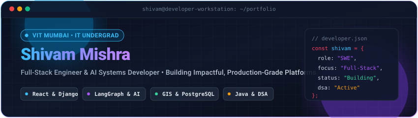

<div align="center">

  <!-- Premium Hero Header -->
  <a href="https://github.com/ShivamMishra2807">
    
  </a>

  <br/><br/>

  <!-- Personalized Greeting & Animated Typing Banner -->
  <h1>Hi, I'm Shivam Mishra </h1>

  <a href="https://readme-typing-svg.demolab.com?font=Fira+Code&weight=600&size=20&pause=1200&color=38BDF8&center=true&vCenter=true&width=680&height=46&lines=Aspiring+Software+Engineer;Full-Stack+Developer+(React+%2B+Django);AI+%26+Agentic+Systems+Enthusiast;Java+%26+DSA+Practitioner;Building+Projects+That+Solve+Real+Problems">
    
  </a>

  <p align="center">
    <strong>Information Technology Undergrad @ Vidyalankar Institute of Technology, Mumbai</strong><br/>
    <em>Engineering modern full-stack web platforms, autonomous AI agent workflows, and practical software solutions.</em>
  </p>

  <!-- Quick Badges Bar -->
  <p align="center">
    <a href="https://www.linkedin.com/in/shivam-mishra-6ba914350/"></a>
    <a href="mailto:shivam.mishra@vit.edu.in"></a>
    <a href="https://github.com/ShivamMishra2807"></a>
  </p>

</div>


## 👨‍💻 About Me

```yaml
student:
  name: Shivam Mishra
  institution: Vidyalankar Institute of Technology (VIT), Mumbai
  degree: B.Tech in Information Technology
  interests: Software Engineering, Full-Stack Architecture, Agentic AI Systems
  current_focus: Java & Data Structures, Scalable Web Applications, Distributed Systems
  aspiration: Software Engineer at high-impact technology organizations
```

- 🎓 **Academic Journey**: Pursuing my **B.Tech in Information Technology** at **Vidyalankar Institute of Technology, Mumbai**.
- 💻 **Engineering Interests**: Focused on full-stack web architecture, backend system design, relational database modeling, and autonomous multi-agent AI workflows.
- ☕ **Core Fundamentals**: Actively practicing **Java, Object-Oriented Design**, and solving **Data Structures & Algorithms (DSA)** problems to sharpen algorithmic intuition.
- 🛠️ **Practical Mindset**: I believe in building projects that solve genuine operational challenges—from national GIS land record governance (`GeoBharat`) to localized multi-agent commerce (`AutoCart`) and e-waste circularity (`EcoCycle`).
- 🎯 **Career Goal**: Aspiring to grow into a versatile Software Engineer at a leading technology firm, contributing to reliable, well-tested, and maintainable systems.


## 🛠️ Technology Stack & Tools

<table>
  <tr>
    <td align="left" width="22%"><strong>Languages</strong></td>
    <td>
      <a href="https://dev.java/"></a>
      <a href="https://www.python.org/"></a>
      <a href="https://developer.mozilla.org/en-US/docs/Web/JavaScript"></a>
      <a href="https://www.typescriptlang.org/"></a>
      <a href="https://en.wikipedia.org/wiki/C_(programming_language)"></a>
      <a href="https://www.w3schools.com/sql/"></a>
    </td>
  </tr>
  <tr>
    <td align="left"><strong>Frontend</strong></td>
    <td>
      <a href="https://react.dev/"></a>
      <a href="https://nextjs.org/"></a>
      <a href="https://vitejs.dev/"></a>
      <a href="https://tailwindcss.com/"></a>
      <a href="https://leafletjs.com/"></a>
      <a href="https://developer.mozilla.org/en-US/docs/Web/HTML"></a>
      <a href="https://developer.mozilla.org/en-US/docs/Web/CSS"></a>
    </td>
  </tr>
  <tr>
    <td align="left"><strong>Backend &amp; APIs</strong></td>
    <td>
      <a href="https://www.djangoproject.com/"></a>
      <a href="https://www.django-rest-framework.org/"></a>
      <a href="https://nodejs.org/"></a>
      <a href="https://expressjs.com/"></a>
      <a href="https://streamlit.io/"></a>
      <a href="https://restfulapi.net/"></a>
    </td>
  </tr>
  <tr>
    <td align="left"><strong>Databases &amp; ORM</strong></td>
    <td>
      <a href="https://www.postgresql.org/"></a>
      <a href="https://www.sqlite.org/"></a>
      <a href="https://www.mongodb.com/"></a>
      <a href="https://www.prisma.io/"></a>
    </td>
  </tr>
  <tr>
    <td align="left"><strong>AI &amp; Agentic Tools</strong></td>
    <td>
      <a href="https://www.langchain.com/langgraph"></a>
      <a href="https://www.langchain.com/"></a>
      <a href="https://ai.google.dev/"></a>
      <a href="https://scikit-learn.org/"></a>
      <a href="https://pandas.pydata.org/"></a>
      <a href="https://numpy.org/"></a>
    </td>
  </tr>
  <tr>
    <td align="left"><strong>DevOps &amp; Workflow</strong></td>
    <td>
      <a href="https://git-scm.com/"></a>
      <a href="https://github.com/"></a>
      <a href="https://github.com/features/actions"></a>
      <a href="https://code.visualstudio.com/"></a>
      <a href="https://www.postman.com/"></a>
      <a href="https://vercel.com/"></a>
    </td>
  </tr>
</table>


## 🚀 Featured Projects

Here is a curated selection of practical, full-stack, and AI-driven platforms I have designed and engineered:

<!-- PROJECT 1: GeoBharat LandStack -->
### 1. 🇮🇳 GeoBharat LandStack — National 3-Layer GIS Land Governance Platform
> **Pan-Indian multi-tier cadastral land governance system uniting citizen services, revenue scrutiny workflows, and GIS vector mapping.**

- 🔗 **Links**: [GitHub Repository](https://github.com/ShivamMishra2807/GeoBharat-LandStack) • [🌐 Live Interactive Demo](https://geo-bharat-land-stack.vercel.app/)
- 💻 **Tech Stack**: `React 18` • `Vite` • `Tailwind CSS` • `Leaflet / GeoJSON` • `Django 6` • `Django REST Framework` • `PostgreSQL / SQLite` • `Zustand`
- 🎯 **Problem Solved**: Fragmented state land record registries in India lack standardized GIS visualization, cross-departmental synchronization, and regional measurement unit equivalence.
- 💡 **Key Highlights**:
  - Implements **Bhu-Aadhaar (ULPIN)** unique parcel identification alongside interactive GeoJSON cadastral layer rendering.
  - Built-in universal regional land unit converter supporting **Bigha, Guntha, Biswa, Acre, and Sq. Meters**.
  - Synchronized scrutiny workflow connecting Citizen applications, Sub-Registrar Offices (SRO), Town Planning, and Revenue Departments with tamper-evident audit logging.

---

<!-- PROJECT 2: AutoCart -->
### 2. 🛍️ AutoCart — AI-Powered Agentic E-Commerce Marketplace
> **Hyper-local marketplace connecting Mumbai neighborhood stores, featuring specialized AI agents with grounded tool execution.**

- 🔗 **Links**: [GitHub Repository](https://github.com/ShivamMishra2807/AutoCart-Agentic-Ai-E-Commerce-Website)
- 💻 **Tech Stack**: `Python 3.12` • `Django` • `Django REST Framework` • `LangGraph` • `LangChain` • `Google Gemini API` • `FastEmbed` • `React 18` • `Tailwind CSS` • `Framer Motion`
- 🎯 **Problem Solved**: Local kirana and retail stores struggle with expensive inventory platforms, while customers lack direct conversational access to verified nearby inventory.
- 💡 **Key Highlights**:
  - Engineered dual agentic assistants powered by **LangGraph state machines**:
    - **Saathi (Customer Agent)**: Conversational shopping assistant that searches live stock and executes cart actions strictly grounded in PostgreSQL/SQLite database state.
    - **Munim (Seller Agent)**: Autonomous store manager providing inventory intelligence, daily sales insights, and automated low-stock notifications.
  - Multi-experience architecture with dedicated interfaces for Shoppers, Shopkeepers, and Administrators.

---

<!-- PROJECT 3: FinVeda -->
### 3. 💳 FinVeda — AI Underwriting & Retail Financial Planning Platform
> **Institutional credit underwriting and debt analysis platform powered by soft-voting ensemble machine learning.**

- 🔗 **Links**: [GitHub Repository](https://github.com/ShivamMishra2807/FinVeda-loan-approval-ml) • [🌐 Live Streamlit Application](https://finveda-loan-approval-ml-vjrgp5aedbdgwznx4d8qym.streamlit.app/)
- 💻 **Tech Stack**: `Python 3.10+` • `Streamlit` • `Scikit-Learn` • `Plotly` • `Pandas` • `NumPy` • `Imbalanced-Learn`
- 🎯 **Problem Solved**: Retail borrowers encounter opaque loan qualification models and lack clear, transparent visibility into EMI borrowing costs and affordability trade-offs.
- 💡 **Key Highlights**:
  - Machine learning underwriting engine combining **Random Forest + Extra Trees + K-Nearest Neighbors** via Soft Voting with transparent factor attribution (DTI, LTI, credit history).
  - Reducing-balance EMI computation engine with edge-case protection, breakdown donut charts, and month-by-month amortization schedules.
  - Multi-scenario comparison tool evaluating up to 3 loan packages side-by-side to minimize total net borrowing outflow.

---

<!-- PROJECT 4: EcoCycle Campus -->
### 4. ♻️ EcoCycle Campus — Circular E-Waste & Zero-Landfill Platform
> **Monorepo sustainability platform for university campuses to collect, repair, reuse, and divert electronic hardware from landfills.**

- 🔗 **Links**: [GitHub Repository](https://github.com/ShivamMishra2807/ecocycle-campus) • [🌐 Live Web App](https://ecocycle-web-nu.vercel.app)
- 💻 **Tech Stack**: `Next.js 15` • `React 19` • `TypeScript` • `Tailwind CSS v4` • `Express.js` • `Prisma ORM` • `PostgreSQL` • `Docker`
- 🎯 **Problem Solved**: Discarded student electronics and laboratory equipment generate hazardous e-waste due to the absence of campus-specific circular recycling and repair pipelines.
- 💡 **Key Highlights**:
  - Monorepo architecture orchestrating circular lifecycles: student pickup scheduling, technician repair diagnostics, and peer-to-peer equipment reuse.
  - Role-based portals for Students, Campus Technicians, and Sustainability Administrators with environmental impact telemetry.

---

<!-- OTHER NOTABLE PROJECTS TABLE -->
### 📌 More Projects & Open Implementations

| Project | Stack | Description | Links |
|:---|:---|:---|:---|
| **🐾 PetCare Management System** | `React 18` `Node.js` `Express` `MongoDB` `JWT` | Full-stack veterinary hospital portal for medical records, patient history, and scheduled appointments. | [Repo](https://github.com/ShivamMishra2807/PetCare-Management-System) |
| **🌤️ Air Quality Dashboard** | `JavaScript` `HTML5` `CSS3` `REST API` | Interactive atmospheric telemetry dashboard with global city search and live AQI index indicators. | [Repo](https://github.com/ShivamMishra2807/air-quality-dashboard) • [Live Demo](https://shivammishra2807.github.io/air-quality-dashboard/) |
| **📊 Chi-Square Hypothesis Engine** | `Python` `SciPy` `Data Analytics` | Statistical test suite evaluating real-world transactional rental datasets to assess categorical dependencies. | [Repo](https://github.com/ShivamMishra2807/Chi_Square_Mini_Project) |


## 📈 GitHub Activity & Engineering Metrics

<div align="center">
  <table border="0">
    <tr>
      <td align="center" width="50%">
        
      </td>
      <td align="center" width="50%">
        
      </td>
    </tr>
    <tr>
      <td align="center" colspan="2">
        <br/>
        
      </td>
    </tr>
  </table>
</div>


## 🐍 Contribution Graph & Activity

<div align="center">
  <picture>
    <source media="(prefers-color-scheme: dark)" srcset="https://raw.githubusercontent.com/ShivamMishra2807/ShivamMishra2807/output/github-contribution-grid-snake-dark.svg" />
    <source media="(prefers-color-scheme: light)" srcset="https://raw.githubusercontent.com/ShivamMishra2807/ShivamMishra2807/output/github-contribution-grid-snake.svg" />
    
  </picture>
  <p><sub><em>Contribution snake dynamically generated via GitHub Actions workflow (<code>.github/workflows/snake.yml</code>).</em></sub></p>
</div>


## 🎯 Current Learning & Growth Roadmap

```
[PROGRESSION ROADMAP 2026]
├── ☕ Java & DSA ........................ [■■■■■■■■□□] (Trees, Graphs, DP & System Architecture)
├── 🤖 Agentic AI & LangGraph ........... [■■■■■■■■□□] (State Machines, Structured Outputs, ReAct Loops)
├── 🏛️ System Design & Backend .......... [■■■■■■■□□□] (Caching, Database Indexing, Concurrency)
└── ☁️ DevOps & Production Pipelines ... [■■■■■■□□□□] (Dockerization, GitHub Actions CI/CD)
```

- 📚 **Data Structures & Algorithms**: Consistently practicing problem-solving in Java, mastering core patterns across binary search, recursion, trees, graphs, and dynamic programming.
- 🤖 **Agentic AI Systems**: Exploring multi-agent state graph orchestration with LangGraph, tool retrieval, and agent memory persistency.
- ⚙️ **Backend Scalability**: Deepening knowledge of relational query optimization, PostgreSQL schema indexing, connection pooling, and RESTful service design.


## 📫 Connect & Collaborate

I am always keen to collaborate on innovative open-source projects, discuss software engineering concepts, or explore internship opportunities. Feel free to reach out!

<div align="center">

  <a href="https://www.linkedin.com/in/shivam-mishra-6ba914350/">
    
  </a>
  &nbsp;
  <a href="mailto:shivam.mishra@vit.edu.in">
    
  </a>
  &nbsp;
  <a href="https://github.com/ShivamMishra2807">
    
  </a>

  <br/><br/>

  <p align="center">
    <sub>Crafted with passion for engineering and clean software architecture. • © Shivam Mishra</sub>
  </p>

</div>
